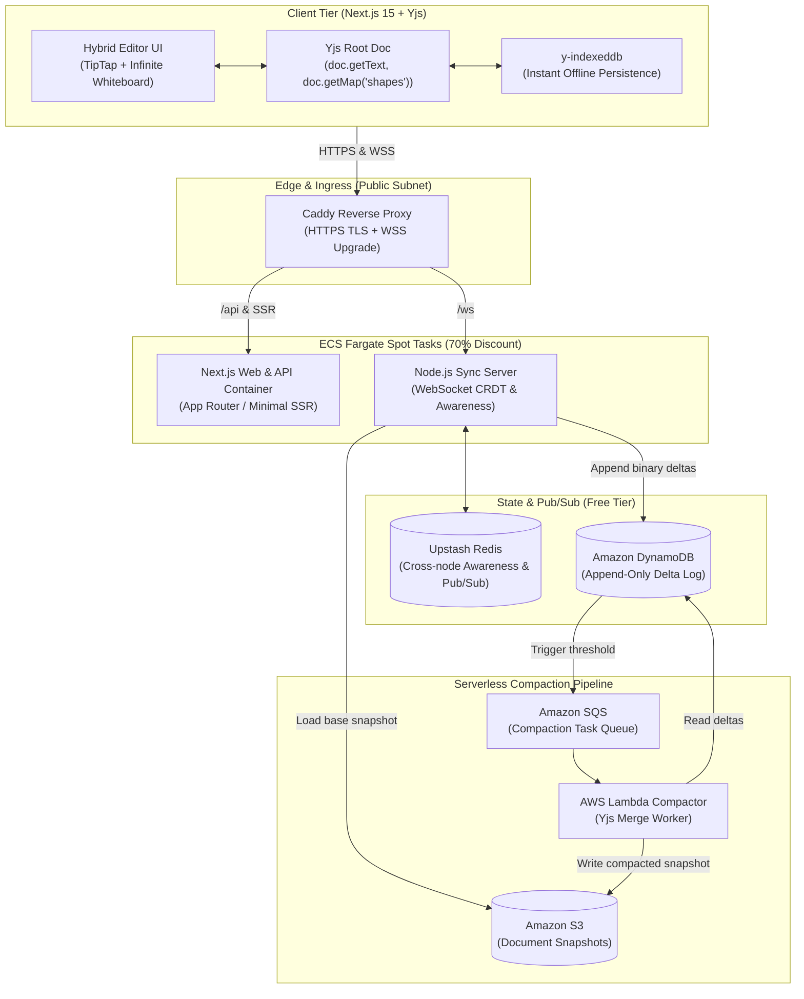

# SyncBytes ⚡

> **A Low-Latency, Real-Time Collaborative Document & Whiteboard Studio built on Yjs CRDTs with a Cost-Optimized ($5/mo) AWS Architecture.**

[](https://github.com/yashrrrr/SyncBytes/actions)
[](LICENSE)
[](https://turbo.build)
[](https://nextjs.org)
[](https://aws.amazon.com)

---

## 🏗️ System Architecture

SyncBytes uses a hybrid collaborative architecture combining **rich-text document editing (TipTap / ProseMirror)** with an **infinite collaborative whiteboard canvas**, synchronized over a unified **Yjs CRDT** data structure.



---

## 💰 The $5/Month AWS Cost Optimization Strategy

Traditional real-time collaboration architectures on AWS frequently cost **$80–$150/month minimum**, even with zero traffic:

| Traditional AWS Component | Typical Cost | SyncBytes Cost-Optimized Alternative | Our Cost |
| :--- | :--- | :--- | :--- |
| **AWS Application Load Balancer (ALB)** | ~$22.00 / mo | **Caddy Reverse Proxy** on single public container | **$0.00** |
| **AWS NAT Gateway** | ~$32.85 / mo + data | **Direct IGW in single public subnet** with strict SGs | **$0.00** |
| **Always-on EC2 / ECS On-Demand** | ~$35.00 / mo | **ECS Fargate Spot (70% discount)** / scale-to-zero | **~$3.50 / mo** |
| **Amazon ElastiCache Redis** | ~$18.00 / mo | **Serverless Redis (Upstash Free Tier)** (10k cmd/day) | **$0.00** |
| **Amazon RDS PostgreSQL** | ~$25.00 / mo | **Serverless Postgres (Supabase / Neon Free Tier)** | **$0.00** |
| **DynamoDB Delta Log** | Variable | **DynamoDB On-Demand** (25 GB Always Free Tier) | **$0.00** |
| **S3 Snapshots & SQS** | Variable | **S3 Standard + SQS (1M requests/mo Always Free)** | **~$0.10 / mo** |
| **Route 53 Hosted Zone** | $0.50 / mo | **Route 53 or Cloudflare Free DNS** | **$0.50 / mo** |
| **Total Baseline Monthly Cost** | **$133.35+ / month** | **SyncBytes Production Stack** | **~ $4.10 / month** |

---

## ⚡ Core Engineering Highlights

### 1. Conflict-Free Replicated Data Types (CRDTs)
* Uses **Yjs** state vectors and binary diffs (`Uint8Array`) to achieve sub-20ms multi-user updates.
* **Guaranteed Eventual Consistency**: Mathematically proves convergence without locking or central arbitration.
* **Offline-First Resilience**: Mutations are immediately committed locally to `IndexedDB` via `y-indexeddb`. Once internet connectivity resumes, accumulated state deltas are cleanly synchronized with zero data loss.

### 2. Append-Only Delta Log + Asynchronous S3 Compaction
* WebSockets **never** write directly to heavy relational tables on every keystroke.
* Incoming binary updates are debounced and flushed into an append-only **DynamoDB** table (`syncbytes_document_deltas`).
* When a document surpasses the delta threshold (e.g. 100 updates) or on room inactivity, an event is sent to **Amazon SQS**.
* An **AWS Lambda Compaction Worker** loads the base S3 snapshot, applies pending DynamoDB deltas with `Y.mergeUpdates`, writes a fresh consolidated snapshot to **Amazon S3**, and purges the compacted deltas.
* **Cold Document Boot**: Initial room hydration requires **1 S3 GET + pending DynamoDB deltas**, loading in <100ms.

### 3. Ephemeral Awareness & Multi-Node Pub/Sub
* Ephemeral data (mouse cursors, user selections, names, and presence colors) are kept in memory and broadcast across cluster nodes using **Redis Pub/Sub** without polluting persistent storage.

---

## 📁 Repository Structure (Turborepo + pnpm)

```text
SyncBytes/
├── apps/
│   ├── web/                    # Next.js 15 (App Router, TipTap, Infinite Canvas, Tailwind)
│   ├── sync-server/            # Node.js WebSocket Server (y-protocols, Redis, DynamoDB)
│   └── compactor/              # AWS Lambda Compactor (esbuild, SQS, S3, DynamoDB)
├── packages/
│   ├── crdt/                   # Yjs hybrid schemas, shape definitions, state convergence
│   ├── config-typescript/      # Shared tsconfig bases (base, node, nextjs)
│   └── config-eslint/          # Shared ESLint configuration
├── infra/
│   ├── docker/                 # Local dev emulators (DynamoDB Local, MinIO, Redis, Caddy)
│   └── terraform/              # Production AWS IaC (VPC, Fargate Spot, ECR, DynamoDB, SQS, S3)
├── .github/
│   └── workflows/
│       ├── ci.yml              # CI lint, typecheck & automated test suite
│       └── deploy.yml          # GitHub Actions AWS OIDC + ECR + Terraform deploy
├── docker-compose.yml          # Zero-cloud local development stack
├── pnpm-workspace.yaml
├── turbo.json
└── package.json
```

---

## 🚀 Quickstart & Local Development

### Prerequisites
* **Node.js** >= 20.0.0
* **pnpm** >= 10.0.0
* **Docker** & Docker Compose (optional for local cloud emulators)

### 1. Clone & Install Dependencies
```bash
git clone https://github.com/yashrrrr/SyncBytes.git
cd SyncBytes
pnpm install
```

### 2. Run the Automated Test Suite
Verify that concurrent edits, CRDT convergence, and delta compaction pass:
```bash
pnpm test
```

### 3. Start Local Emulators (Optional)
Start local DynamoDB, MinIO (S3 mock), Redis, and Caddy:
```bash
pnpm local:up
pnpm local:init
```

### 4. Run Development Servers
Launch both Next.js and the WebSocket sync server concurrently:
```bash
pnpm dev
```
* **Web Client**: Open [http://localhost:3000](http://localhost:3000)
* **WebSocket Endpoint**: `ws://localhost:4000/ws/:docId`

---

## 🛠️ Production AWS Deployment (Terraform)

Deploy the entire cost-optimized AWS infrastructure using Terraform:

```bash
cd infra/terraform
terraform init
terraform plan
terraform apply
```

To configure GitHub Actions automated deployments:
1. Set up an AWS IAM OIDC Identity Provider for your GitHub repository.
2. Add `AWS_ROLE_ARN` and `AWS_REGION` to your GitHub Repository Secrets.
3. Push to `main` branch: GitHub Actions will automatically run type checks, tests, build Docker containers to Amazon ECR, and perform zero-downtime rolling updates to ECS Fargate Spot.

---

## 📜 License

MIT License. Designed and engineered for production-grade real-time collaboration.
